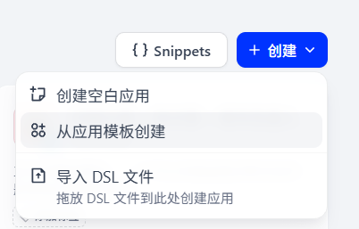
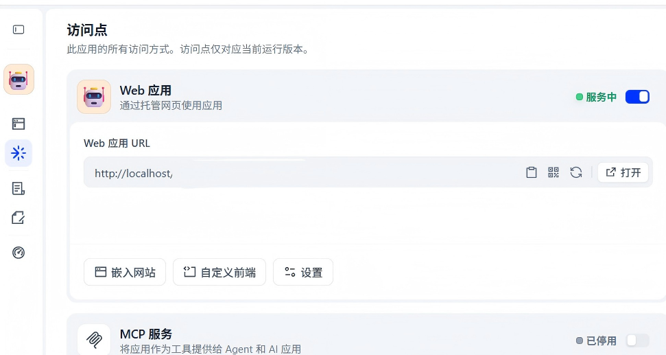

# PL 英语听力助手 · 部署与使用手册

一套完整的项目：**Dify Chatflow 工作流（简单版AI听力生成）+ 本地 iframe 前端**。

工作流是一个 CET-4 英语听力 AI 助手：能根据概率决策树随机选题材 → 用 Firecrawl 爬取真实英文新闻 → 按四级词表扩写成 News Report 听力正文 → 生成题目 → 通过 TTS 合成音频；同时支持做题技巧、考务注意事项、情感陪伴三类问答（走知识库 RAG）。

前端负责把这套工作流以 iframe 形式嵌进一个本地网页，用户打开 `http://localhost:5173` 就能直接对话使用。

## 目录结构

```
dify-agent-web/
├── index.html                  前端页面结构
├── assets/
│   ├── css/style.css           样式（浅色主题）
│   └── js/app.js               配置解析 / iframe 挂载 / postMessage 通信
├── workflow/
│   └── 简单版AI听力生成.yml     Dify DSL 工作流文件（导入 Dify 用）
├── docs/
│   ├── import-dsl.png          导入 DSL 的入口截图
│   └── webapp-embed.png        访问点 / 嵌入网站入口截图
├── start.bat                   Windows 一键启动前端
└── README.md
```

## 整体架构

```
┌─────────────────────────── 你的电脑 ───────────────────────────┐
│                                                                │
│  浏览器  ──►  本前端 (localhost:5173)                           │
│                  │  iframe 嵌入                                │
│                  ▼                                             │
│  Dify（云端 dify.ai 或本地 docker compose）                      │
│    ├─ Chatflow：分类 → 爬虫 → 扩写 → 出题 → TTS                │
│    ├─ 模型：通义千问 qwen3.8-max / qwen3-rerank（DashScope Key）│
│    ├─ 爬虫：Firecrawl（Firecrawl API Key）                      │
│    └─ TTS：Kokoro-FastAPI（本地 docker，OpenAI 兼容接口）        │
│                                                                │
└────────────────────────────────────────────────────────────────┘
```

---

# 第一步 · 准备好三个 API Key

| # | 用途                      | 在哪申请                                                         | 填到哪                       |
| - | ----------------------- | ------------------------------------------------------------ | ------------------------- |
| 1 | 千问大模型（对话/分类/扩写/出题/重排）   | 阿里云百炼（DashScope）控制台                                          | 插件「通义千问 Tongyi」           |
| 2 | Firecrawl 网页爬取（抓英文新闻素材） | 按 <https://github.com/firecrawl/firecrawl> 官方指引注册并申请 API Key | 插件「Firecrawl」             |
| 3 | Kokoro TTS（本地语音合成）      | 本地部署，不需要申请，Key 随意填非空字符串                                      | 插件「OpenAI-API-compatible」 |

> TTS 也可以不用本地 Kokoro，直接在 TTS 节点的模型下拉里切换成千问的 `qwen3-tts-flash`（走 Key 1），云端部署时这样更省事，见下文。

# 第二步 · 跑通 Dify 工作流（二选一）

## 方式 A：云端 Dify（Dify 官网）

适合不想折腾本地环境、只想快速体验的情况。

**1. 导入 DSL**

登录 <https://cloud.dify.ai/> 的控制台，在工作室页面点右上角 **「创建」→「导入 DSL 文件」**，把本项目 `workflow/简单版AI听力生成.yml` 拖进去即可：



**2. 安装插件**

导入时 Dify 会提示缺少依赖插件，按提示在「插件市场」全部装上：

- **通义千问（langgenius/tongyi）**：所有 LLM / 重排模型都在用它
- **Agent（langgenius/agent）**：Agent 节点的函数调用策略
- **Firecrawl（langgenius/firecrawl）**：爬取新闻网页
- **OpenAI-API-compatible（langgenius/openai_api_compatible）**：接 Kokoro TTS

**3. 填入 API Key**

在右上角头像 →「设置」→「模型供应商 / 工具」里：

（其实可以自己自行改变配置）

- 通义千问：填 DashScope API Key（Key 1）
- Firecrawl：填 Firecrawl API Key（Key 2）
- OpenAI-API-compatible：见下方 Kokoro 部署

**4. ⚠️ 关于云端 Dify + 本地 Kokoro**

注意一个关键点：**云端 Dify 跑在官方服务器上，它默认访问不到你电脑上的 `localhost`**。所以有两种解法：

- **推荐（最省事）**：把工作流里「文本转语音」节点的模型从 `tts-1`（OpenAI 兼容）切换成 `qwen3-tts-flash`（通义千问），直接走云端合成，本地什么都不用装；
- **坚持用 Kokoro**：先在本地把 Kokoro 跑起来（见下节），再用内网穿透工具（ngrok、Cloudflare Tunnel 等）把它暴露成公网地址，然后在 OpenAI-API-compatible 插件里填穿透后的地址。

## 方式 B：本地部署 Dify（推荐给想完整掌控环境的同学）

本地部署 Dify 的步骤请直接读官方仓库，写得比我复述的更权威：

> **Dify 本地部署：<https://github.com/langgenius/dify>**
>
> 核心就是克隆仓库后进入 `docker` 目录执行 `docker compose up -d`，然后把浏览器打开到 `http://localhost` 完成初始化。插件安装、Key 填写与云端完全一致。

本地部署的好处是 Kokoro 可以直连 `localhost`，不用穿透。流程：

1. 按官方 README 部署好 Dify；
2. 部署本地 Kokoro TTS（下一节）；
3. 按方式 A 同样的方法导入 DSL、装插件、在图形化编排页面里给各节点填好 Key；
4. 打开工作流对话界面即可运行。

## 本地部署 Kokoro TTS

项目地址：<https://github.com/remsky/Kokoro-FastAPI>（按仓库 README 操作）。

一行命令跑起 CPU 版：

```bash
docker run -p 8880:8880 ghcr.io/remsky/kokoro-fastapi-cpu
```

然后在 Dify 的「设置 → 模型供应商 → OpenAI-API-compatible」里添加模型：

- **模型类型**：TTS
- **模型名称**：`tts-1`（与工作流 TTS 节点里已选的名字一致）
- **API Key**：随意填一个非空字符串（本地服务默认无鉴权）
- **API Base URL**：`http://localhost:8880/v1`

配好后，工作流「文本转语音」节点的模型下拉里选 `tts-1`（音色 `af_bella`），就是走本地 Kokoro。

## 第三步（重要）· 重新绑定知识库

DSL 导入后，**三个知识库检索节点不会带着知识库一起过来**（知识库是按 ID 引用的），需要自己重建：

| 节点名      | 用途          | 建议内容       |
| -------- | ----------- | ---------- |
| 情感类RAG   | 陪伴、鼓励类对话的语料 | 学习心理疏导相关文档 |
| 做题技巧类RAG | 四级听力做题方法    | 真题技巧总结文档   |
| 注意事项类RAG | 考务注意事项      | 四六级考务官方说明  |

步骤：在 Dify「知识库」里分别上传文档建好三个库 → 回到工作流编排页 → 点开对应的「知识检索」节点 → 重新选择你刚建的知识库，同时确认重排模型（`qwen3-rerank`）可用。

> 不绑也能跑，只是问到技巧 / 注意事项 / 情感类问题时回答质量会下降。

---

# 第三步 · 接入本地前端（iframe 嵌入）

工作流跑通后，把它嵌进本前端：

**1. 拿到 WebApp 地址**

在 Dify 控制台打开这个应用，点左侧栏的 **「访问点」**（火箭图标），在 **Web 应用** 卡片里能看到 WebApp URL，点 **「嵌入网站」** 可以直接复制 iframe 代码：



**2. 启动本前端**

双击 `start.bat`，或手动执行：

```bash
python -m http.server 5173 --bind 127.0.0.1
```

打开 <http://localhost:5173>。

**3. 配置连接**

点右上角「设置」，把刚才的 WebApp 链接（如 `http://localhost/chatbot/AbCdEfGhIjKlMnOp`）粘进第一行，地址和 Token 会自动解析，点「保存并连接」即可。云端 Dify 的话，填它在云端的地址和 Token。

> 也支持 URL 参数快速初始化：  
> `http://localhost:5173/?base=http://localhost&token=你的Token`

**4. 开始对话**

右侧对话区就是 Dify 的 WebApp：输入「帮我生成英语听力」，按提示选 News report 的短篇 / 长篇 / 三篇，等它爬新闻、写正文、出题、合成音频即可。

## 前端功能一览

| 功能        | 说明                                      |
| --------- | --------------------------------------- |
| iframe 嵌入 | 按 Dify WebApp 规范拼接 `sys.user_id` 等参数    |
| 连接状态灯     | 未连接 / 连接中 / 已就绪 / 连接失败，带超时兜底            |
| 快捷提问      | 侧栏输入 + 推荐问题，`postMessage` 投递，失败自动复制到剪贴板 |
| 新建会话      | 重新挂载 iframe，开启全新对话                      |
| 连接自检      | 区分「Dify 没启动」和「Token 错 / 被拦截」            |
| 专注模式      | 隐藏侧栏，只留对话区                              |
| 嵌入代码      | 一键复制生成好的 iframe 代码，贴进任何页面               |
| 本地持久化     | 配置存 `localStorage`，下次打开免填               |

---

# 常见问题

**生成到一半回复「对不起，生成错误，请重试」**

这是 Agent 节点的失败分支被触发了，九成是 Firecrawl 抓取失败：检查 Key 2 是否有效、是否有余额/额度，或目标新闻站当次恰好爬不动，重试即可。

**TTS 节点报错 / 没有音频**

- 本地 Kokoro：`docker ps` 确认容器在跑，浏览器访问 `http://localhost:8880` 有响应；
- OpenAI-API-compatible 插件里的 Base URL 必须是 `http://localhost:8880/v1`（本地）或穿透地址（云端 Dify）；
- 云端 Dify 想省事就直接切 `qwen3-tts-flash`。

**模型报错「model not found」之类**

工作流里写的是 `qwen3.8-max` / `qwen3-rerank`，如果你的百炼账号没有这个型号，在各个 LLM 节点和知识库重排设置里换成你账号可用的千问模型即可（如 `qwen-max`、`gte-rerank`）。

**导入 DSL 后打开聊天没反应 / 回答质量差**

检查三个知识库节点是否已重新绑定（见上文第三步）。

**前端 iframe 空白 / 一直转圈**

1. 点「连接自检」——不可达说明 Dify 没启动或端口写错（要带端口，如 `http://localhost:8088`）；
2. 可达但空白 → Token 填错，或应用类型选错（Chatflow 选 `chatbot`）；
3. 控制台出现 `X-Frame-Options` / `frame-ancestors` 报错 → Dify 的 nginx 拒绝被嵌套，把前端地址 `http://localhost:5173` 加进 `frame-ancestors` 白名单后重启 nginx。

**混合内容被拦截**

Dify 与前端一个 `https` 一个 `http` 时浏览器会拦，保持两边协议一致即可。

---

# 相关链接

- Dify（云端 / 本地部署官方仓库）：<https://github.com/langgenius/dify>
- Kokoro-FastAPI（本地 TTS）：<https://github.com/remsky/Kokoro-FastAPI>
- Firecrawl（网页爬取，按 README 申请 API Key）：<https://github.com/firecrawl/firecrawl>

# 技术说明

- 前端零依赖、零构建，原生 HTML + CSS + JS，改完刷新即生效。
- iframe 地址构造：`{baseUrl}/{appType}/{token}?sys.user_id=...`
- 与 iframe 的通信统一走 `window.postMessage`，`targetOrigin` 使用配置的 Dify origin，不使用 `*`。
- 用户标识首次访问时自动生成并写入 `localStorage`，可用于 Dify 侧的会话隔离。
